# Product API on AWS ECS

A Go + Gin implementation of the Product endpoints from the course's `api.yaml`, deployed to AWS ECS (Fargate) with Terraform, load tested with Locust, and instrumented with Prometheus metrics and structured JSON logs. Products are stored in memory, so they are lost whenever the task restarts.

| Method | Path | Responses |
|---|---|---|
| `GET` | `/products/{productId}` | `200`, `404`, `500` |
| `POST` | `/products/{productId}/details` | `204`, `400`, `404`, `500` |
| `GET` | `/metrics` | Prometheus metrics (see [Observability](#observability-part-v)) |

**Contents**

- [Where everything is](#where-everything-is)
- [Deploy from your machine](#deploy-from-your-machine)
- [Send requests](#send-requests)
- [Examples of every response code](#examples-of-every-response-code)
- [Load testing with Locust (Part IV)](#load-testing-with-locust-part-iv)
- [Observability (Part V)](#observability-part-v)
- [Deploying code changes](#deploying-code-changes) · [Run locally](#run-locally-optional) · [Clean up](#clean-up) · [Troubleshooting](#troubleshooting)

There are two ways to use this repo:

- **Deploy your own copy** to your own AWS Learner Lab account: follow [Deploy from your machine](#deploy-from-your-machine), then [Send requests](#send-requests).
- **Send requests to someone else's deployment**: ask them for their server's IP, then go straight to [Send requests](#send-requests). The IP changes every time their task restarts, so check it's current.

## Where everything is

```
.
├── src/                          # Server
│   ├── product-service.go        #   handlers, metrics, JSON request logging
│   ├── go.mod / go.sum
│   └── Dockerfile                #   multi-stage build, linux/amd64 for Fargate
├── terraform/                    # Infrastructure
│   ├── main.tf                   #   wires the modules together, builds and pushes the image
│   ├── variables.tf              #   region, names, port, task count
│   ├── provider.tf               #   AWS + Docker providers
│   ├── outputs.tf
│   └── modules/
│       ├── network/              #   security group (port 8080), default VPC subnets
│       ├── ecr/                  #   image repository
│       ├── logging/              #   CloudWatch log group
│       └── ecs/                  #   cluster, task definition, service
├── postman/
│   └── product-api.postman_collection.json   # one request per response code, with tests
├── locust/
│   └── locustfile.py             # load test, GET:POST ratios 3:1, 1:1, 1:3
├── observability/                # Local Prometheus + Grafana stack
│   ├── docker-compose.yml
│   ├── prometheus.yml
│   ├── grafana/                  #   datasource + RED dashboard, auto-provisioned
│   └── logs/request-log-excerpt.md
└── screenshots/
```

### What `terraform apply` deploys

1. Creates an ECR repository.
2. Builds the Docker image from `src/` and pushes it to ECR.
3. Creates a CloudWatch log group, a security group that opens port `8080`, an ECS cluster, a task definition (0.25 vCPU, 512 MiB) and an ECS service.
4. Starts one Fargate task with a public IP in the default VPC.

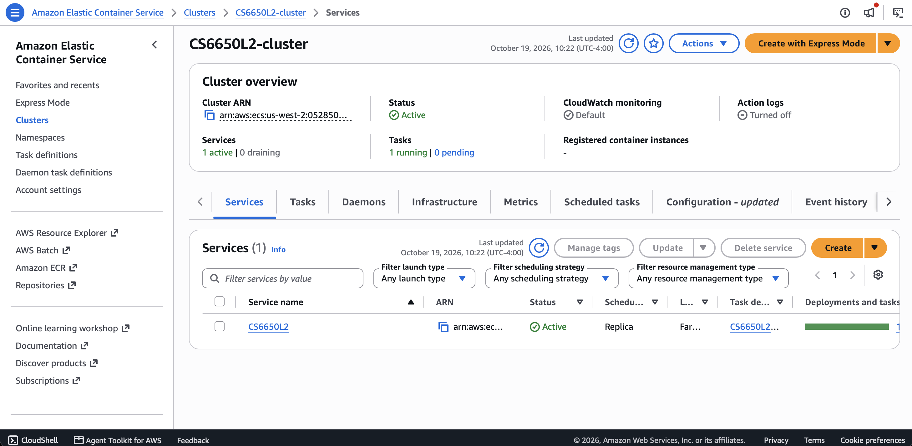

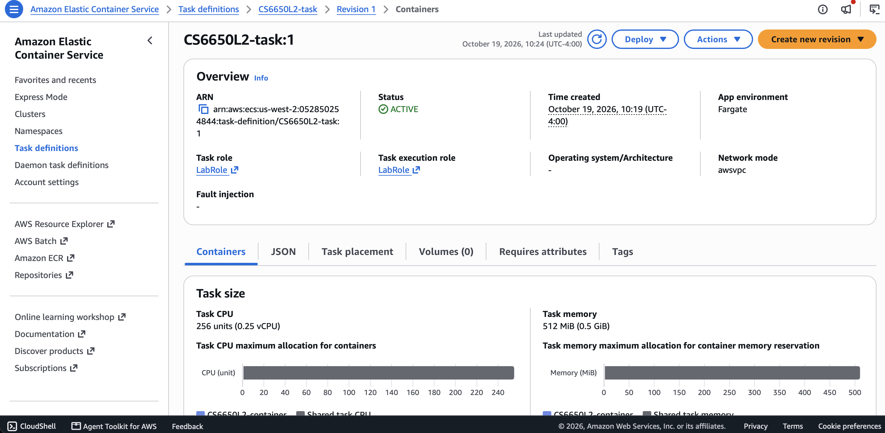

## Deploy from your machine

### 1. Install the prerequisites

| Tool | Check it's installed | Install (macOS) |
|---|---|---|
| Terraform 1.5+ | `terraform -version` | `brew tap hashicorp/tap && brew install hashicorp/tap/terraform` |
| AWS CLI v2 | `aws --version` | `brew install awscli` |
| Docker Desktop | `docker info` | [docker.com](https://www.docker.com/products/docker-desktop/) |
| Git | `git --version` | `xcode-select --install` |

You also need your own **AWS Academy Learner Lab** session. The Terraform reuses the lab's `LabRole` IAM role, so it won't work in a regular AWS account without changes. Each person deploys into their own lab account, so group members don't conflict with each other.

### 2. Get the code

```bash
git clone https://github.com/ameir-elouadi/CS6650_2b_demo.git
cd CS6650_2b_demo
```

### 3. Set your AWS credentials

In Learner Lab, click **Start Lab** and wait for the dot to turn green. Then open **AWS Details** → **AWS CLI: Show**. It shows a block like this:

```
[default]
aws_access_key_id=...
aws_secret_access_key=...
aws_session_token=...
```

Copy the whole block into `~/.aws/credentials`, replacing anything already there. To open the file:

```bash
mkdir -p ~/.aws && touch ~/.aws/credentials && open -e ~/.aws/credentials
```

Then set the region:

```bash
aws configure set region us-west-2
```

Check that it worked. This should print your account details, not an error:

```bash
aws sts get-caller-identity
```

Learner Lab credentials expire when the session ends (about 4 hours). After restarting the lab, paste the new block into `~/.aws/credentials` again. Never commit credentials to the repo.

### 4. Start Docker

Open Docker Desktop and wait until `docker info` runs without an error. Terraform builds the image on your machine, so Docker must be running during `terraform apply`.

On macOS, also point Terraform at Docker Desktop's socket. Run this in the same terminal you'll run Terraform from:

```bash
export DOCKER_HOST=unix://$HOME/.docker/run/docker.sock
```

Without it, Terraform fails with `Cannot connect to the Docker daemon at unix:///var/run/docker.sock`.

### 5. Deploy

From the repo root:

```bash
cd terraform
terraform init
terraform apply
```

Terraform lists what it will create (`Plan: 8 to add, 0 to change, 0 to destroy`) and asks for confirmation. Type `yes`. The first run takes a few minutes, mostly for the image build and push. It ends with:

```
Apply complete! Resources: 8 added, 0 changed, 0 destroyed.

Outputs:

aws_region = "us-west-2"
ecs_cluster_name = "CS6650L2-cluster"
ecs_service_name = "CS6650L2"
```

### 6. Get the server's public IP

Fargate gives the task a new public IP each time it starts, so look it up after every deploy. Wait about a minute after `terraform apply` finishes, then run this from the `terraform/` folder:

```bash
REGION=$(terraform output -raw aws_region)
CLUSTER=$(terraform output -raw ecs_cluster_name)
SERVICE=$(terraform output -raw ecs_service_name)

TASK=$(aws ecs list-tasks --region $REGION \
  --cluster $CLUSTER --service-name $SERVICE \
  --query 'taskArns[0]' --output text)

ENI=$(aws ecs describe-tasks --region $REGION \
  --cluster $CLUSTER --tasks $TASK \
  --query "tasks[0].attachments[0].details[?name=='networkInterfaceId'].value" \
  --output text)

IP=$(aws ec2 describe-network-interfaces --region $REGION \
  --network-interface-ids $ENI \
  --query 'NetworkInterfaces[0].Association.PublicIp' --output text)

echo "API: http://$IP:8080"
```

If `TASK` comes back as `None`, or the IP is empty, the task hasn't started yet. Wait 30–60 seconds and run the commands again.

You can also find the IP in the AWS console: **ECS** → **Clusters** → `CS6650L2-cluster` → **Tasks** → click the running task → **Public IP**.

## Send requests

### Set the IP

If you just ran step 6, `$IP` is already set in that terminal. Otherwise, set it to the server's IP:

```bash
IP=<SERVER-IP>
```

Every command below uses `$IP`, so run them all in the same terminal window.

### Run the requests

Paste each block on its own, in this order: the `200` GET needs the product created by the `204` POST. `-i` makes curl print the status line first, e.g. `HTTP/1.1 204 No Content`.

The JSON bodies are split across short lines on purpose. If a long one-line command wraps when you copy it, a line break can land inside a string like `"Acme Corporation"`, and the API rejects it with `400 invalid character '\n' in string literal`.

#### POST /products/{productId}/details

**204 No Content: product created** (or replaced, if it already exists)
```bash
curl -i -X POST http://$IP:8080/products/12345/details \
  -H "Content-Type: application/json" \
  -d '{
    "product_id": 12345,
    "sku": "ABC-123-XYZ",
    "manufacturer": "Acme Corporation",
    "category_id": 456,
    "weight": 1250,
    "some_other_id": 789
  }'
```
```
HTTP/1.1 204 No Content
```

**400 Bad Request: invalid input**

All six fields are required and must follow the limits in `api.yaml`. The `product_id` in the body must match the one in the URL.
```bash
curl -i -X POST http://$IP:8080/products/12345/details \
  -H "Content-Type: application/json" \
  -d '{"product_id": 12345}'
```
```
HTTP/1.1 400 Bad Request

{"error":"INVALID_INPUT","message":"The provided input data is invalid","details":"Key: 'Product.SKU' Error:Field validation for 'SKU' failed on the 'required' tag ..."}
```

**404 Not Found: invalid product ID**

A product ID that isn't a positive 32-bit integer (e.g. `abc` or `0`) can't identify a product.
```bash
curl -i -X POST http://$IP:8080/products/abc/details \
  -H "Content-Type: application/json" \
  -d '{
    "product_id": 12345,
    "sku": "ABC-123-XYZ",
    "manufacturer": "Acme Corporation",
    "category_id": 456,
    "weight": 1250,
    "some_other_id": 789
  }'
```
```
HTTP/1.1 404 Not Found

{"error":"NOT_FOUND","message":"Product not found","details":"product ID must be a positive 32-bit integer"}
```

**500 Internal Server Error: simulated failure**

Any request with the header `X-Simulate-Error: true` returns `500`, so the error response can be tested.
```bash
curl -i -X POST http://$IP:8080/products/12345/details \
  -H "Content-Type: application/json" \
  -H "X-Simulate-Error: true" \
  -d '{
    "product_id": 12345,
    "sku": "ABC-123-XYZ",
    "manufacturer": "Acme Corporation",
    "category_id": 456,
    "weight": 1250,
    "some_other_id": 789
  }'
```
```
HTTP/1.1 500 Internal Server Error

{"error":"INTERNAL_ERROR","message":"Internal server error"}
```

#### GET /products/{productId}

**200 OK: product found**
```bash
curl -i http://$IP:8080/products/12345
```
```
HTTP/1.1 200 OK

{"product_id":12345,"sku":"ABC-123-XYZ","manufacturer":"Acme Corporation","category_id":456,"weight":1250,"some_other_id":789}
```

**404 Not Found: product doesn't exist**
```bash
curl -i http://$IP:8080/products/99999
```
```
HTTP/1.1 404 Not Found

{"error":"NOT_FOUND","message":"Product not found"}
```

**500 Internal Server Error: simulated failure**
```bash
curl -i http://$IP:8080/products/12345 -H "X-Simulate-Error: true"
```
```
HTTP/1.1 500 Internal Server Error

{"error":"INTERNAL_ERROR","message":"Internal server error"}
```

In zsh, a `%` at the end of a response just means the body didn't end with a newline. It isn't part of the response.

## Examples of every response code

`postman/product-api.postman_collection.json` has one request for every response code of both endpoints, plus extra `400` cases (malformed JSON, values outside the limits, path/body ID mismatch). Each request has a test that checks the status code.

**In the Postman app:** click **Import** and choose the file. Click the **Product API** collection → **Variables**, set `baseUrl` to `http://<SERVER-IP>:8080`, and save. Then right-click the collection → **Run collection**, keeping the default order (the POSTs create the product the GET `200` needs).

**From the terminal** with the [Postman CLI](https://learning.postman.com/docs/postman-cli/postman-cli-installation/):

```bash
postman collection run postman/product-api.postman_collection.json \
  --env-var baseUrl=http://$IP:8080
```

Run against the ECS deployment, all 11 requests return the expected code and all 21 assertions pass:

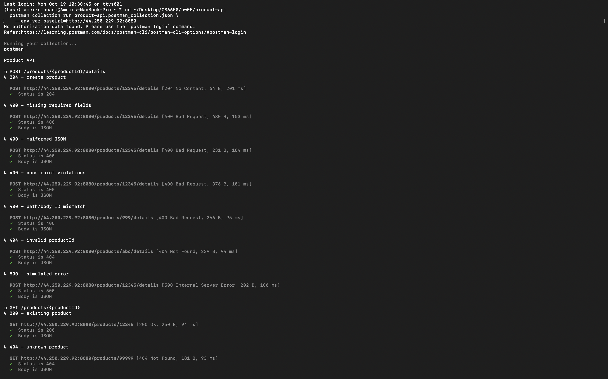

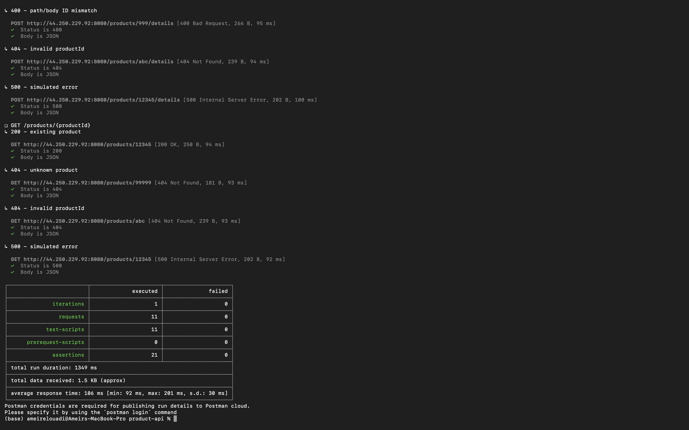

## Load testing with Locust (Part IV)

`locust/locustfile.py` simulates users that create a product and then mix GETs and POSTs, with a 0.1–0.5 s wait between requests. Each user's GETs only ask for products it created, so they return `200`. The GET:POST ratio is picked in the web UI from three user classes: `ReadHeavy3to1`, `Balanced1to1`, `WriteHeavy1to3`. Load-test products use IDs 1,000,000–2,000,000, so they never clash with the examples above.

Install Locust with `pip install locust`, then start a master and one worker from the `locust/` folder, in two terminals:

```bash
locust -f locustfile.py --master --class-picker --host http://$IP:8080
```
```bash
locust -f locustfile.py --worker --master-host 127.0.0.1
```

Open http://localhost:8089, pick a user class, enter the number of users and ramp-up, and click **Start**. Start more worker processes for more workers. Each worker uses one CPU core, so check the **Workers** tab: if a worker is near 100% CPU, Locust is the bottleneck rather than the server.

### Part IV run: 3:1, 1 worker, 50 users, ramp-up 10 users/s (against ECS)

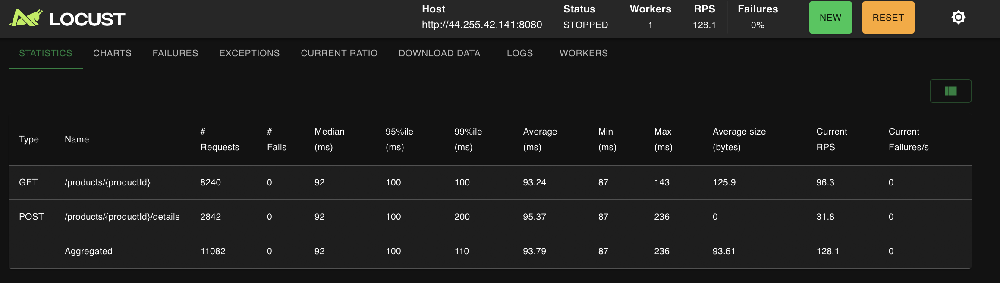

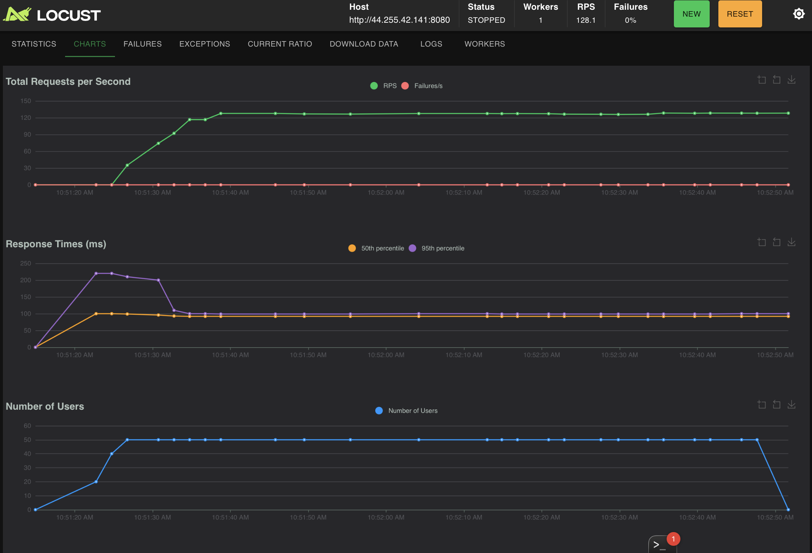

### Other parameters (4 workers, against ECS)

| Run | Users | GET:POST | Requests | Failures | Median | p95 | p99 | RPS |
|---|---|---|---|---|---|---|---|---|
| Part IV | 50 (1 worker) | 3:1 | 11,082 | 0 | 92 ms | 100 ms | 110 ms | 128 |
| A | 200 | 3:1 | 72,549 | 0 | 93 ms | 100 ms | 110 ms | 505 |
| B | 200 | 1:1 | 59,785 | 0 | 93 ms | 100 ms | 110 ms | 504 |
| C | 200 | 1:3 | 76,364 | 0 | 93 ms | 100 ms | 110 ms | 504 |
| D | 500 | 3:1 | 136,622 | 0 | 93 ms | 100 ms | 160 ms | 1,269 |
| E | 1,000 | 3:1 | 129,366 | 0 | 100 ms | 260 ms | 480 ms | 2,328 |

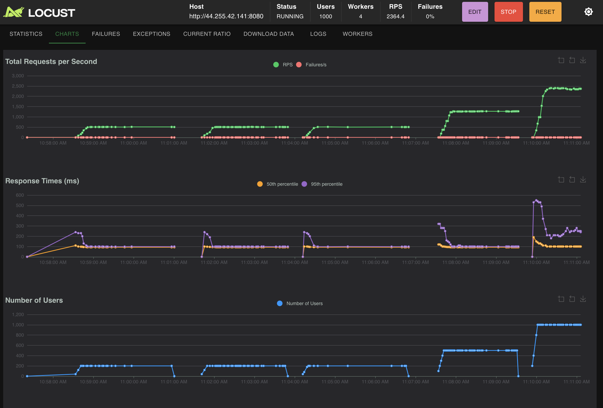

<details>
<summary>Statistics screenshots for runs A–E</summary>

**A: 200 users, 3:1**
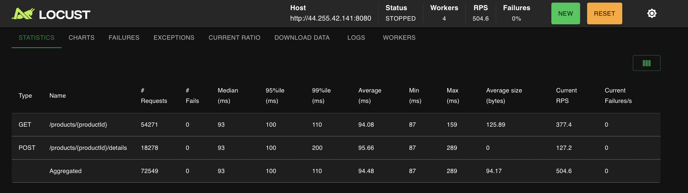

**B: 200 users, 1:1**
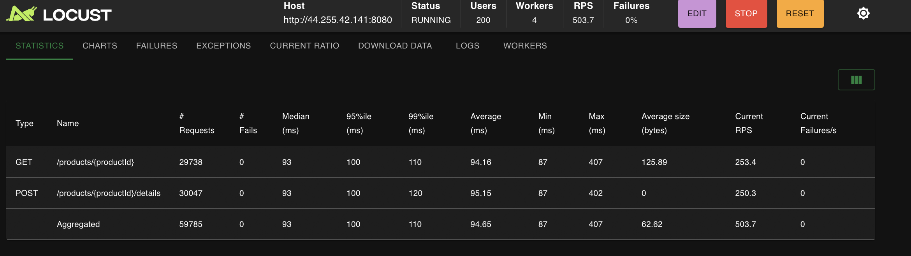

**C: 200 users, 1:3**
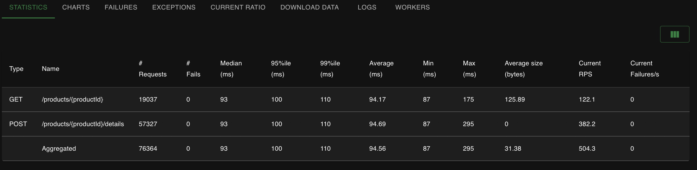

**D: 500 users, 3:1**
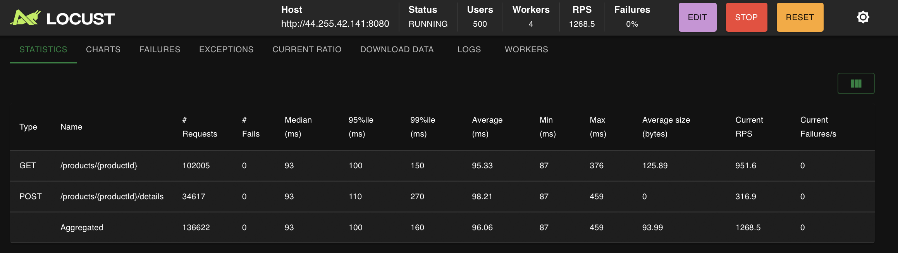

**E: 1,000 users, 3:1**
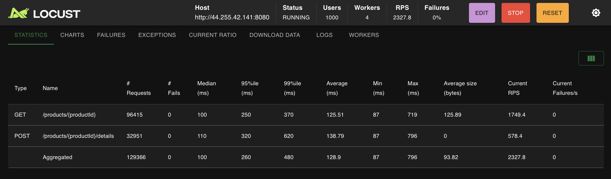

</details>

### What the results show

- **No failures in any run.** Throughput grew with the number of users, from 128 to about 2,330 RPS.
- **Most of the response time is network.** The median stayed at 92–100 ms in every run. That's the round trip from a laptop to `us-west-2`: the server itself handles a request in well under a millisecond (see [Observability](#observability-part-v)).
- **The GET:POST ratio made no measurable difference at 200 users.** Runs A, B and C have the same latency and RPS. The in-memory store's lock isn't a bottleneck at this load.
- **Stress first appears at 1,000 users.** The median rose to 100 ms, p95 more than doubled (100 → 260 ms) and p99 tripled (160 → 480 ms), while RPS was lower than the ~2,500 that 1,000 users would send if latency had stayed flat. Requests were starting to queue, either in the 0.25 vCPU Fargate task or in the 4 Locust workers on one laptop. Comparing the ECS task's CPU with the Locust **Workers** tab during the run tells which.

## Observability (Part V)

The server tracks the **RED** signals for every endpoint, two ways:

**1. Metrics.** `GET /metrics` exposes, labelled by method and endpoint (route template, e.g. `/products/:productId`):

| Signal | Metric | Type |
|---|---|---|
| Rate | `http_requests_total{method, endpoint, status}` | counter |
| Errors | `http_request_errors_total{method, endpoint, status}` (non-2xx) | counter |
| Duration | `http_request_duration_seconds{method, endpoint}` | histogram, 50 µs to ~1.6 s buckets |

**2. Logs.** Each request writes one JSON line to stdout with the endpoint, status code and duration. On ECS these go to CloudWatch (`/ecs/CS6650L2`). A simulated `500` also records the panic in an `error` field:

```json
{"time":"2026-10-19T15:20:35.187Z","level":"INFO","msg":"request","method":"GET","endpoint":"/products/:productId","path":"/products/12345","status":500,"duration_ms":1.175,"error":"simulated error"}
```

Both are recorded by one Gin middleware, `observe`, in `src/product-service.go`.

### Run Prometheus + Grafana locally

The metrics stack runs locally with Docker Compose, next to a local copy of the API. It isn't deployed to AWS.

```bash
cd observability
docker compose up --build -d
```

| Service | URL |
|---|---|
| Product API | http://localhost:8080 |
| Prometheus | http://localhost:9090 (scrapes the API every 5 s) |
| Grafana | http://localhost:3000 (no login, opens on the **Product API: RED signals** dashboard) |

Point Locust at `http://localhost:8080` to generate load. To read the request logs:

```bash
docker compose logs app --no-log-prefix
```

Stop everything with `docker compose down`.

### Dashboard: idle vs. loaded

The Locust run used the Part IV settings (3:1, 1 worker, 50 users, ramp-up 10 users/s) against the local API, from 11:24:50 to 11:28:56. The minutes before it are idle.

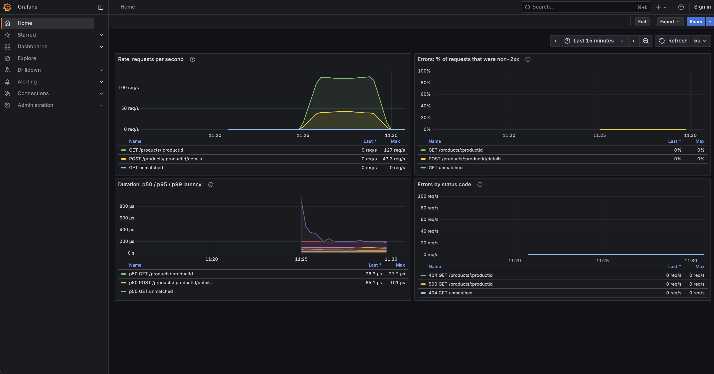

- **Rate:** 0 req/s while idle, then a plateau of about 125 GET + 42 POST req/s (3:1) during the run, then back to 0.
- **Errors:** 0% throughout. Every load-test request succeeded. While idle there's no traffic, so there's no error rate to draw.
- **Duration:** p50 is about 26 µs for GET and 85 µs for POST under load, and p99 is about 200 µs. The spike to ~850 µs at the start is the server warming up.

The local run reaches more RPS than the ECS Part IV run (~165 vs. 128) with the same 50 users, because there's no network round trip, so each user sends its next request sooner.

### Request log excerpt from the same run

From [`observability/logs/request-log-excerpt.md`](observability/logs/request-log-excerpt.md), which also has idle, ramp-up and slowest-request lines:

```json
{"time":"2026-10-19T15:24:50.056152554Z","level":"INFO","msg":"request","method":"POST","endpoint":"/products/:productId/details","path":"/products/1799923/details","status":204,"duration_ms":0.205}
{"time":"2026-10-19T15:26:54.139976959Z","level":"INFO","msg":"request","method":"GET","endpoint":"/products/:productId","path":"/products/1626765","status":200,"duration_ms":0.032}
{"time":"2026-10-19T15:26:54.15183225Z","level":"INFO","msg":"request","method":"GET","endpoint":"/products/:productId","path":"/products/1125859","status":200,"duration_ms":0.025}
{"time":"2026-10-19T15:26:15.28279451Z","level":"INFO","msg":"request","method":"POST","endpoint":"/products/:productId/details","path":"/products/1465831/details","status":204,"duration_ms":6.147}
{"time":"2026-10-19T15:28:56.467499126Z","level":"INFO","msg":"request","method":"POST","endpoint":"/products/:productId/details","path":"/products/1537734/details","status":204,"duration_ms":0.103}
```

The same RED numbers, computed from the log lines alone for the loaded period (246 s):

| Endpoint | Requests | Rate | Errors | p50 | p95 | p99 |
|---|---|---|---|---|---|---|
| `GET /products/:productId` | 30,405 | 123.4 req/s | 0% | 0.02 ms | 0.05 ms | 0.08 ms |
| `POST /products/:productId/details` | 10,120 | 41.1 req/s | 0% | 0.09 ms | 0.15 ms | 0.20 ms |

### Dashboard vs. logs

I'd look at the dashboard to see what's happening right now, or to spot a trend: is latency or the error rate rising, and when did it start? It shows aggregate RED numbers at a glance. I'd go to the logs after the fact, or when I need the detail behind an aggregate: each request's path, status code, duration and error message is recorded, so I can find exactly which requests failed or were slow, even if nobody had Grafana open at the time.

## Deploying code changes

The service always runs the `latest` image tag, so after editing code in `src/`, rebuild the image and restart the task. From `terraform/`, with Docker running and `DOCKER_HOST` set (step 4):

```bash
terraform apply -replace=docker_image.app -replace=docker_registry_image.app
aws ecs update-service --region $(terraform output -raw aws_region) \
  --cluster $(terraform output -raw ecs_cluster_name) \
  --service $(terraform output -raw ecs_service_name) \
  --force-new-deployment > /dev/null
```

The new task gets a new IP, so repeat [step 6](#6-get-the-servers-public-ip) after a minute.

## Run locally (optional)

```bash
cd src
go mod tidy
go run product-service.go
```

Or with Docker:

```bash
cd src
docker build -t product-api .
docker run --rm -p 8080:8080 product-api
```

Then set `IP=localhost` and use the requests above. To run it with Prometheus and Grafana, see [Observability](#run-prometheus--grafana-locally).

## Clean up

When you're done, delete everything so it doesn't keep using lab credits. From `terraform/`:

```bash
terraform destroy
```

Type `yes` to confirm. Run it from the same machine and folder you deployed from, since that's where Terraform keeps its state.

## Troubleshooting

| Problem | Fix |
|---|---|
| `ExpiredToken` or `InvalidClientTokenId` | The lab session ended. Restart it and redo [step 3](#3-set-your-aws-credentials). |
| `Cannot connect to the Docker daemon` | Start Docker Desktop and wait until `docker info` works, then redo the `export DOCKER_HOST=...` line from [step 4](#4-start-docker) in the same terminal. |
| `curl` times out | The task may still be starting, or it restarted with a new IP. Wait a minute and redo [step 6](#6-get-the-servers-public-ip). |
| `400` with `invalid character '\n' in string literal` | A line break got pasted inside a JSON string. Copy the request again as one block from this README. |
| Task keeps stopping | Check the logs: `aws logs tail /ecs/CS6650L2 --region us-west-2 --since 15m` |
| `RepositoryAlreadyExistsException` or `ResourceAlreadyExists` | A previous deploy in this lab account wasn't destroyed. Run `terraform destroy` from the same folder, or delete the leftover resources in the AWS console. |
| Port `8080`, `9090` or `3000` already in use | Another copy of the API or the stack is running. Stop it, or run `docker compose down` in `observability/`. |

The Docker image is built for `linux/amd64`, the architecture Fargate uses by default, so it deploys correctly from both Intel and Apple Silicon Macs. On Apple Silicon, the local Docker Compose stack runs it under emulation, which is slower than native but fine for comparing idle vs. loaded.
